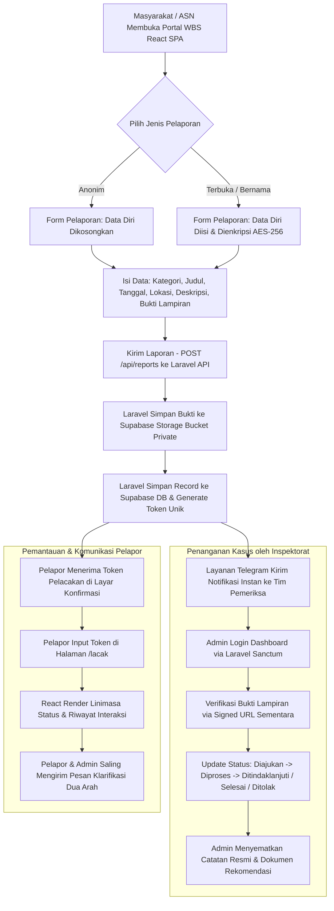

# Product Requirements Document (PRD)
## Whistleblowing System (WBS) - Inspektorat Kota Padang

---

### 1. INFORMASI DOKUMEN
- **Nama Produk:** Whistleblowing System (WBS) Inspektorat Daerah Kota Padang
- **Versi Dokumen:** 1.1.0 (Target Migration Architecture)
- **Status:** Approved / Active
- **Pemilik Produk:** Inspektorat Daerah Kota Padang
- **Target Pengguna:** Masyarakat Umum, Aparatur Sipil Negara (ASN), Tim Pengawas / Auditor Inspektorat Kota Padang
- **Target Arsitektur:** React (Frontend Vite) + Laravel (REST API) + Supabase (PostgreSQL & Storage) + Vercel Deployment

---

### 2. LATAR BELAKANG & TUJUAN
Dalam rangka mewujudkan tata kelola pemerintahan yang bersih, transparan, dan berintegritas (*good governance & clean government*), Pemerintah Kota Padang melalui Inspektorat Daerah memerlukan kanal pengaduan pelanggaran yang aman, rahasia, dan dapat diakses dengan mudah oleh seluruh lapisan masyarakat maupun ASN.

Tujuan utama sistem ini adalah:
1. **Perlindungan Penuh Pelapor (Whistleblower Protection):** Menyediakan fasilitas pelaporan dengan opsi identitas anonim atau terenkripsi tingkat tinggi (AES-256) guna mencegah intimidasi dan pembalasan.
2. **Kanal Terpusat:** Menyatukan seluruh jenis laporan tindak pidana korupsi, pungutan liar (pungli), gratifikasi, benturan kepentingan, dan pelanggaran disiplin ASN ke dalam satu pintu resmi.
3. **Transparansi Melalui Token Unik:** Memberikan token rahasia kepada pelapor untuk melacak perkembangan status laporan tanpa perlu membuat akun atau membocorkan identitas.
4. **Respon Cepat (Quick Alert):** Mengintegrasikan sistem dengan notifikasi instan Telegram Bot agar tim pemeriksa Inspektorat dapat langsung merespon pengaduan baru secara *real-time*.
5. **Modernisasi Sistem & Skalabilitas:** Mengadopsi teknologi *Enterprise Decoupled* (React + Laravel + Supabase di Vercel) untuk menjamin keandalan, responsivitas tinggi, dan isolasi keamanan data bukti pengaduan.

---

### 3. USER PERSONAS

| Persona | Peran | Kebutuhan Utama | Tantangan / Pain Points |
| :--- | :--- | :--- | :--- |
| **Pelapor Anonim (Masyarakat / ASN)** | Mengadukan indikasi korupsi/pungli tanpa membuka identitas. | Jaminan kerahasiaan 100%, kemudahan melampirkan bukti, pelacakan tanpa login. | Takut identitas bocor, takut ancaman hukum atau mutasi jabatan. |
| **Pelapor Terbuka (ASN / Publik)** | Menyampaikan laporan resmi dengan identitas terverifikasi. | Perlindungan hukum, kejelasan tindak lanjut, saluran klarifikasi/komunikasi dua arah. | Proses birokrasi berbelit, minimnya respon penanganan. |
| **Tim Verifikator Inspektorat (Admin)** | Meninjau kelayakan bukti, verifikasi substansi, mengubah status laporan. | Dashboard cepat, filter status, preview dokumen lampiran, komunikasi rahasia dengan pelapor. | Banyak laporan palsu/kurang bukti, beban investigasi manual. |
| **Inspektur / Pimpinan Pengawasan** | Memantau kinerja penanganan kasus dan statistik laporan berkala. | Ringkasan statistik, audit trail penanganan kasus, laporan ringkas. | Kebutuhan data rekapitulasi cepat untuk pelaporan berkala ke Walikota & KPK. |

---

### 4. USER JOURNEY & WORKFLOW

---

### 5. KEBUTUHAN FUNGSIONAL (FUNCTIONAL REQUIREMENTS)

#### 5.1 Modul Publik (Pelapor)
- **FR-01 (Kanal Pengaduan Multi-Kategori):** Pengguna dapat memilih kategori dugaan pelanggaran secara interaktif:
  - Korupsi / Kerugian Keuangan Negara
  - Pungutan Liar (Pungli)
  - Gratifikasi / Suap
  - Penyalahgunaan Wewenang / Jabatan
  - Pelanggaran Disiplin / Kode Etik ASN
  - Pelayanan Publik Buruk
  - Lainnya
- **FR-02 (Opsi Pelaporan Anonim / Bernama):** Pelapor bebas memilih opsi anonim (100% tanpa identitas) atau mencantumkan Nama, NIK, No. HP, dan Email yang langsung dienkripsi oleh backend Laravel sebelum masuk ke database Supabase.
- **FR-03 (Unggah Bukti Lampiran Aman):** Mendukung unggah dokumen pendukung (gambar, PDF) dengan validasi ukuran berkas, disimpan pada **Supabase Storage Bucket Private**, dan diakses menggunakan *Signed URL* berwaktu kedaluwarsa.
- **FR-04 (Token Rahasia Kriptografis):** Setiap laporan sukses akan menghasilkan Token Unik (format: `WBS-PADANG-XXXXXX`) yang acak, aman, dan tidak dapat ditebak.
- **FR-05 (Pelacakan Status Mandiri):** Pelapor dapat memeriksa progres laporan secara *real-time* kapan saja melalui menu Lacak Laporan hanya dengan token tanpa perlu membuat akun.
- **FR-06 (Interaksi Komunikasi Dua Arah):** Pelapor dan tim auditor dapat saling mengirim pesan klarifikasi/tambahan bukti pada linimasa riwayat pengaduan secara rahasia.

#### 5.2 Modul Pengawasan (Admin Inspektorat)
- **FR-07 (Autentikasi Terproteksi Laravel Sanctum):** Login admin dengan proteksi *brute force*, password hashing bcrypt (*cost factor* 12), token stateless Sanctum, dan auto-logout setelah masa berlaku sesi habis.
- **FR-08 (Dashboard Statistik Real-Time):** Menampilkan metrik total laporan masuk, laporan pending/diajukan, laporan dalam proses, dan laporan selesai secara reaktif.
- **FR-09 (Manajemen & Filter Laporan):** Admin dapat memfilter laporan berdasarkan status (Semua, Diajukan, Diproses, Ditindaklanjuti, Selesai, Ditolak) serta pencarian kata kunci.
- **FR-10 (Telaah & Pembaruan Status):** Admin dapat mengubah status laporan disertai catatan resmi tindak lanjut wajib dan opsi mengunggah berkas rekomendasi.
- **FR-11 (Ganti Password Mandiri):** Admin dapat memperbarui kata sandi secara aman dari dashboard melalui verifikasi kata sandi lama dan hashing instan.
- **FR-12 (Notifikasi Telegram Terintegrasi):** Notifikasi otomatis dikirimkan ke grup/kanal Telegram pengawas begitu ada laporan baru masuk dari publik.

---

### 6. KEBUTUHAN NON-FUNGSIONAL (NON-FUNCTIONAL REQUIREMENTS)

| Kategori | Parameter | Spesifikasi |
| :--- | :--- | :--- |
| **Security** | Kerahasiaan Data | Enkripsi AES-256 untuk data pribadi pelapor; Bcrypt (salt round 12) untuk kredensial admin; Row Level Security (RLS) pada Supabase. |
| **Security** | Proteksi Serangan | HTTP Security Headers, Content Security Policy (CSP), HSTS 1 tahun, Rate Limiting Laravel Throttle (100 req/min API, 5 req/min Login), Anti-XSS, Anti-SQLi via Eloquent ORM. |
| **Performance** | Waktu Muat (Load Time) | Frontend React di-bundle Vite dengan *code splitting* dan *tree shaking*, disajikan melalui Vercel Edge CDN dengan FCP < 0.8 detik. |
| **Availability** | Ketersediaan Sistem | 99.9% Uptime berkat integrasi Vercel Edge Network dan Supabase High-Availability PostgreSQL dengan connection pooler Supavisor. |
| **Usability** | Desain Antarmuka | Mengikuti Kaidah Desain Visual 60:30:10, Tipografi Golden Ratio (Public Sans & Inter), Responsif penuh (Desktop, Tablet, Smartphone). |
| **Kepatuhan Hukum** | Regulasi Privasi | Kepatuhan terhadap UU No. 27 Tahun 2022 tentang Perlindungan Data Pribadi (UU PDP) dan standar penanganan WBS KPK/Kemenpan-RB. |

---

### 7. MATRIKS PRIORITAS FITUR (MoSCoW)

- **Must Have (Kritis):**
  - Form pengaduan dengan opsi anonimitas mutlak.
  - Pelacakan laporan menggunakan Token Kriptografis.
  - Enkripsi data identitas dan hashing password admin.
  - Integrasi berkas bukti aman ke Supabase Storage.
  - Dashboard admin untuk verifikasi dan perubahan status.
  - Rate limiting dan keamanan header HTTP.
- **Should Have (Penting):**
  - Notifikasi instan via Telegram Bot API.
  - Komunikasi dua arah pelapor-auditor dalam timeline laporan.
  - Fitur ganti password admin terintegrasi.
  - Supavisor connection pooling untuk performa tinggi.
- **Could Have (Tambahan Nilai):**
  - Ekspor laporan rekapitulasi berkala ke format Excel/PDF untuk kebutuhan audit tahunan.
  - Integrasi WhatsApp Gateway untuk notifikasi SMS/WA alternatif.
- **Won't Have (Saat Ini):**
  - Registrasi akun publik berbasis email/KTP (ditiadakan demi menjaga anonimitas mutlak pelapor).

---

### 8. INDIKATOR KEBERHASILAN (KPI)
1. **Zero Data Breach:** 0 kebocoran data identitas pelapor dan tidak ada insiden unauthorized access.
2. **Response Time:** Kecepatan respon telaah awal laporan oleh verifikator Inspektorat < 3 hari kerja sejak pengaduan diajukan.
3. **Public Trust Metric:** Peningkatan partisipasi pelaporan indikasi kecurangan tanpa kendala teknis (0 bug kritis pada alur pengaduan).
