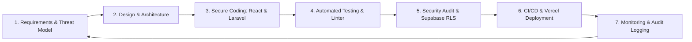

# Software Development Life Cycle (SDLC)
## Whistleblowing System (WBS) - Inspektorat Kota Padang

---

### 1. MODEL PENGEMBANGAN: AGILE DEVSECOPS
Proyek Whistleblowing System (WBS) Inspektorat Daerah Kota Padang dikembangkan menggunakan pendekatan **Agile Scrum terintegrasi dengan prinsip DevSecOps**. Karena sistem ini memproses data pengaduan sensitif dan berisiko tinggi terhadap serangan keamanan, setiap tahapan siklus hidup perangkat lunak memadukan aspek keamanan informasi (*Security by Design*) sejak awal (*shift-left security*).



---

### 2. TAHAPAN SIKLUS HIDUP (SDLC PHASES)

#### Fase 1: Analisis Kebutuhan & Threat Modeling
- **Aktivitas:** 
  - Wawancara kebutuhan regulasi pengawasan intern pemerintah (Inspektorat Kota Padang).
  - Identifikasi jenis pelanggaran dan dokumen pembuktian.
  - Penyusunan *Threat Modeling* menggunakan metodologi STRIDE untuk memetakan potensi celah keamanan (pencurian identitas, pemalsuan bukti, eksfiltrasi database, kebocoran token).
- **Deliverables:** Dokumen PRD, Matriks Kebutuhan Fungsional, dan Pemetaan Aset Kritis.

#### Fase 2: Desain Sistem & Antarmuka (UI/UX)
- **Aktivitas:**
  - Perancangan arsitektur terpisah (*Decoupled Architecture*): React SPA di Vercel dan REST API Laravel terhubung ke Supabase.
  - Implementasi Standar Desain Visual:
    - **60:30:10 Rule:** 60% latar belakang bersih/netral (`#f8fafc`), 30% warna institusi (*Deep Navy Blue* `#1e3a8a`), 10% aksen interaktif (*Royal Blue* `#2563eb`).
    - Skala Tipografi & Spacing berbasis rasio harmonis Golden Ratio (~1.618).
    - Tipografi: *Public Sans* untuk heading resmi dan *Inter* untuk keterbacaan teks utama.
- **Deliverables:** Prototipe UI Komponen React, Konfigurasi Tailwind CSS, dan Skema Migrasi Basis Data Supabase.

#### Fase 3: Pengkodean Aman (Secure Coding & Implementation)
- **Aktivitas:**
  - **Frontend (React 18 + Vite):** Komponen modular (`ReportForm`, `TrackingTimeline`, `AdminDashboard`), state terisolasi, sanitasi input XSS, dan *protected routes*.
  - **Backend (Laravel 11 REST API):** Arsitektur MVC/Service, Eloquent ORM, enkripsi field sensitif via `Crypt::encryptString()`, dan autentikasi stateless via Laravel Sanctum.
  - **Penyimpanan Berkas (Supabase Storage):** Berkas bukti tidak disimpan di database langsung, melainkan diunggah ke private bucket dengan akses berbasis *Signed URL*.
- **Aturan Pengkodean (Coding Rules):**
  - Tidak diperbolehkan menyisipkan rahasia/kredensial ke dalam repositori (selalu gunakan `.env`).
  - Wajib menggunakan *Form Request Validation* untuk seluruh endpoint penerima input.
  - Semua kueri basis data wajib menggunakan Eloquent / Query Builder (*parameterized by default*) untuk mencegah *SQL Injection*.

#### Fase 4: Pengujian & Quality Assurance (QA)
Pengujian dilakukan berlapis untuk menjamin fungsionalitas dan keandalan sistem:
1. **Static Analysis & Linting:**
   - Frontend: ESLint + Prettier untuk memastikan standar kode React bersih.
   - Backend: PHPStan / Laravel Pint untuk memastikan standar kodingan PHP (PSR-12).
2. **Automated Unit & Feature Testing:**
   - Backend: PHPUnit / Pest untuk menguji alur pengajuan laporan, validasi token, rate limiting, dan autentikasi Sanctum.
   - Frontend: Vitest / React Testing Library untuk memastikan komponen form dan pelacakan render dengan benar.
3. **Security Vulnerability Assessment:**
   - Uji coba manipulasi parameter, otorisasi token palsu, uji batas *Rate Limiting* (100 req/min API publik, 5 req/min login).
   - Verifikasi *Security Headers* (CSP, HSTS, X-Frame-Options: DENY, X-Content-Type-Options: nosniff).
4. **Cross-Browser & Responsiveness Testing:**
   - Validasi kompatibilitas di peramban utama (Chrome, Edge, Firefox, Safari Mobile).

#### Fase 5: Penyebaran (Deployment & CI/CD Pipeline)
- **Frontend Deployment (Vercel):**
  - Git integration otomatis men-trigger build Vite (`npm run build`).
  - Penyebaran instan ke Vercel Edge Network dengan caching aset statis dan kompresi Brotli otomatis.
- **Backend Deployment (Laravel):**
  - Menggunakan pipeline CI/CD GitHub Actions: menjalankan pengujian, menjalankan migrasi basis data ke Supabase (`php artisan migrate --force`), dan deploy.
- **Database Deployment (Supabase):**
  - Manajemen skema terpusat melalui Laravel Migrations yang dieksekusi ke Supabase PostgreSQL via connection string pooler (port 6543 / 5432).

#### Fase 6: Operasional & Pemeliharaan (Maintenance)
- **Monitoring & Audit Logging:** Pencatatan otomatis riwayat aksi verifikator pada tabel `report_history` serta error log terpusat.
- **Data Retention & Automated Backup:** Snapshot harian basis data Supabase otomatis aktif dengan retensi aman.
- **Patch Management:** Pembaruan rutin paket dependensi (`npm audit` & `composer audit`) untuk mencegah kerentanan rantai pasok (*supply-chain vulnerability*).

---

### 3. STRATEGI PERCABANGAN GIT (BRANCHING STRATEGY)

Sistem menggunakan alur kerja berbasis **GitFlow**:

```
[main] ──────────────────────────●──────────● (Production Vercel Live: v1.1.0)
                                 ▲          ▲
[staging] ──────●──────●─────────┘          │ (Staging / QA Supabase Sandbox)
                ▲      ▲                    │
[feature/*] ────┘      │                    │ (Fitur baru: feature/react-upload-zone)
[hotfix/*] ────────────┴────────────────────┘ (Perbaikan darurat bug/keamanan)
```

1. **`main`:** Cabang produksi utama. Setiap merge ke cabang ini otomatis memicu deployment produksi di Vercel.
2. **`staging`:** Cabang pra-rilis terhubung ke preview deployment Vercel dan Supabase test project.
3. **`feature/<nama-fitur>`:** Cabang kerja untuk modul spesifik (misal: `feature/react-dashboard`, `feature/supabase-storage`).
4. **`hotfix/<nama-perbaikan>`:** Cabang darurat langsung dari `main` untuk penanganan celah keamanan kritis.

---

### 4. MANAJEMEN ENVIRONMENT

| Komponen | Frontend (React / Vercel) | Backend (Laravel) | Database & Storage (Supabase) |
| :--- | :--- | :--- | :--- |
| **Development** | `VITE_API_BASE_URL=http://localhost:8000/api` | `DB_CONNECTION=pgsql` (Supabase Dev) | Supabase Local / Free Tier Project |
| **Staging** | `VITE_API_BASE_URL=https://staging-api.wbs.padang.go.id/api` | `APP_ENV=staging`, `APP_DEBUG=false` | Supabase Staging Project |
| **Production** | `VITE_API_BASE_URL=https://api.wbs.padang.go.id/api` | `APP_ENV=production`, `APP_DEBUG=false` | Supabase High-Availability Prod Project |

---

### 5. MANAJEMEN RILIS & VERSIONING (SEMVER 2.0)

Penomoran rilis mengacu pada standar **Semantic Versioning (MAJOR.MINOR.PATCH)**:
- **MAJOR (v2.0.0):** Perubahan fundamental arsitektur sistem atau protokol API yang tidak kompatibel dengan versi sebelumnya (*breaking changes*).
- **MINOR (v1.1.0):** Migrasi arsitektur ke React + Laravel + Supabase tanpa mengubah alur dan fungsionalitas bagi pengguna akhir.
- **PATCH (v1.1.1):** Perbaikan bug, perbaikan tata letak UI, atau pembaruan keamanan tanpa perubahan skema utama.

---

### 6. PROSEDUR ROLLBACK & PEMULIHAN BENCANA (DISASTER RECOVERY)

1. **Rollback Frontend di Vercel:**
   - Gunakan fitur *Instant Rollback* pada dashboard Vercel untuk mengembalikan versi frontend yang stabil dalam hitungan detik.
2. **Rollback Backend Laravel:**
   - Eksekusi rollback rilis via GitHub Actions / deployment manager (`git revert` / `php artisan migrate:rollback`).
3. **Rollback Basis Data Supabase:**
   - Supabase menyediakan fitur *Point-in-Time Recovery (PITR)* dan snapshot harian otomatis untuk memulihkan keadaan basis data sebelum insiden terjadi.
