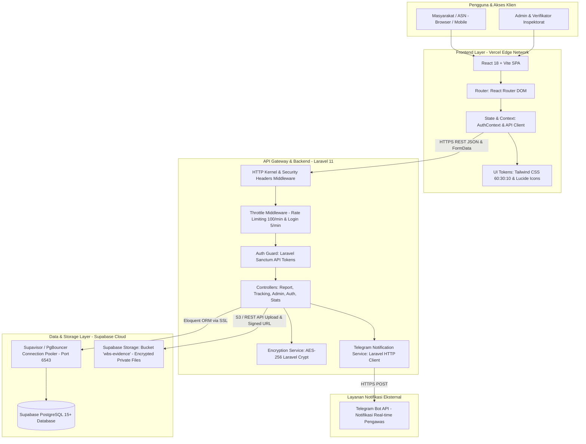

# Technical Stack & Architecture Document (Target Migration)
## Whistleblowing System (WBS) - Inspektorat Kota Padang

---

### 1. RINGKASAN ARSITEKTUR TARGET
Sistem Pengaduan Pelanggaran (*Whistleblowing System*) Inspektorat Daerah Kota Padang dimigrasikan ke arsitektur **Enterprise Decoupled Modern Stack**:
- **Frontend:** **React (v18+)** dengan build-tool **Vite** & Tailwind CSS (Custom Design System 60:30:10).
- **Backend API:** **Laravel (v11/v10)** dengan PHP 8.2+, Eloquent ORM, Laravel Sanctum, dan Form Request Validation.
- **Basis Data & Storage:** **Supabase** (PostgreSQL 15+ Managed, Supavisor Connection Pooling, dan Supabase Storage S3-compatible untuk berkas bukti lampiran).
- **Infrastruktur & Deployment:** **Vercel** untuk Frontend React (Edge CDN Global) dan Serverless PHP / Hybrid Hosting terpadu.



---

### 2. PERBANDINGAN ARSITEKTUR: SEBELUM VS SESUDAH MIGRASI

| Komponen | Arsitektur Lama (Legacy) | Arsitektur Baru (Target Migration) | Keuntungan & Peningkatan |
| :--- | :--- | :--- | :--- |
| **Frontend Framework** | Vanilla JS (DOM Manipulation manual di `app.js`) | **React 18 + Vite** | Modularitas komponen, *reactive state management*, performa re-render optimal, penanganan formulir dinamis yang kuat. |
| **Desain & Styling** | Vanilla CSS monolitik (`style.css` 2500+ baris) | **Tailwind CSS + Design Tokens 60:30:10** | Konsistensi desain terjaga melalui konfigurasi `tailwind.config.js`, bebas CSS class conflict, dan otomatis *purged* (ukuran CSS produksi < 15 KB). |
| **Backend Framework** | Node.js Express.js monolith (`server.js`) | **Laravel 11 (PHP 8.2+) REST API** | Arsitektur standar enterprise pemerintah, validasi *Form Request* ketat, Eloquent ORM aman dari SQLi, *service provider* terstruktur. |
| **Autentikasi Admin** | Custom In-Memory Map Session Token | **Laravel Sanctum (Stateless Bearer Tokens)** | Token terenkripsi aman tersimpan di database/cache, mendukung multi-device, pencabutan token seketika (*instant revoke*). |
| **Penyimpanan Berkas** | Base64 String di dalam kolom database (`file_data TEXT`) | **Supabase Storage (Bucket S3 Private)** | Ukuran database tetap ramping dan cepat; berkas disimpan secara terisolasi dengan akses via *Signed URL* berwaktu kedaluwarsa. |
| **Basis Data** | SQLite lokal / PostgreSQL generik manual | **Supabase PostgreSQL 15+ & Supavisor** | Koneksi *pooling* tahan konkurensi tinggi, *automated daily backup*, pemantauan kinerja bawaan, dan fitur *Row Level Security (RLS)*. |
| **Deployment** | Node server manual / fallback Vercel adapter | **Vercel Edge Network + Serverless/Cloud** | *Zero-config deployment*, kompresi otomatis Brotli/Gzip, *global CDN*, dan *instant rollback* bila terjadi galat. |

---

### 3. JAMINAN ZERO FEATURE LOSS (TABEL PEMETAAN FITUR LENGKAP)

Seluruh fitur yang ada pada sistem sebelumnya dipertahankan secara utuh dan ditingkatkan keandalannya:

| ID Fitur | Nama Fitur | Implementasi Lama | Implementasi Baru (React + Laravel + Supabase) | Status Jaminan |
| :--- | :--- | :--- | :--- | :--- |
| **FR-01** | Multi-Kategori Pengaduan | Dropdown `<select>` statis di HTML | Komponen `<CategorySelect />` interaktif dengan ikon SVG, deskripsi indikasi, dan filter cerdas. | **100% Terpenuhi** (Ditingkatkan) |
| **FR-02** | Opsi Anonim / Bernama | Toggle checkbox JS di `app.js` | State React `isAnonim` dengan transisi mulus; data pelapor dienkripsi via `Crypt::encryptString()` di Laravel. | **100% Terpenuhi** (Ditingkatkan) |
| **FR-03** | Unggah Bukti Lampiran | `FileReader` Base64 ke string DB | `<FileUploadZone />` dengan validasi MIME/ekstensi (.pdf, .jpg, .png), diunggah ke **Supabase Storage**. | **100% Terpenuhi** (Ditingkatkan) |
| **FR-04** | Token Rahasia Kriptografis | `crypto.randomBytes(4)` di Node | `Str::upper('WBS-PADANG-' . Str::random(8))` di Laravel Controller (Unik & Cryptographically Secure). | **100% Terpenuhi** |
| **FR-05** | Pelacakan Laporan Mandiri | Input token dan render div manual | Halaman `/lacak` dengan komponen `<TimelineTracking />`, menampilkan status tahapan pengaduan secara visual. | **100% Terpenuhi** (Ditingkatkan) |
| **FR-06** | Komunikasi 2 Arah Pelapor-Auditor | Render tabel riwayat dan form komentar | Chat/Timeline linimasa interaktif dengan lampiran balasan dan indikator pengirim (Pelapor vs Inspektorat). | **100% Terpenuhi** (Ditingkatkan) |
| **FR-07** | Autentikasi Admin Terproteksi | Bcrypt manual + In-Memory Map | **Laravel Sanctum**, hashing Bcrypt cost 12, rate limit 5x gagal $\rightarrow$ lockout 15 menit. | **100% Terpenuhi** (Ditingkatkan) |
| **FR-08** | Dashboard Statistik Real-time | Endpoint `/api/reports/stats` | Komponen `<StatCard />` reaktif dengan query agregat Eloquent (`count()`, `whereStatus()`). | **100% Terpenuhi** |
| **FR-09** | Filter & Pencarian Laporan | Filter JS sisi klien pada array `reports` | Filter server-side terpaginasi (status, rentang tanggal, kata kunci judul) dengan performa tinggi. | **100% Terpenuhi** (Ditingkatkan) |
| **FR-10** | Telaah & Update Status Laporan | Modal form dan fetch update status | `<StatusUpdateModal />` dengan validasi catatan resmi wajib dan unggahan berkas rekomendasi tindak lanjut. | **100% Terpenuhi** |
| **FR-11** | Ganti Password Mandiri | Update ke berkas `.env` | Endpoint `PUT /api/admin/password` dengan validasi password lama, konfirmasi password, dan update hash. | **100% Terpenuhi** (Ditingkatkan) |
| **FR-12** | Notifikasi Telegram Instan | `https.request` native di Node.js | Layanan `TelegramService` via Laravel HTTP Client dengan format Markdown pesan rapi dan tautan dashboard. | **100% Terpenuhi** |

---

### 4. RINCIAN STACK TEKNOLOGI BARU

#### 4.1 Frontend (React + Vite)
- **Framework:** React 18.3+ (Functional Components & Hooks).
- **Tooling:** Vite 5+ (Hot Module Replacement super cepat, build bundle optimal via Rollup).
- **Routing:** `react-router-dom` v6+ dengan pembagian rute publik dan `<AdminRouteGuard>`.
- **Styling:** Tailwind CSS v3+ dengan kustomisasi token warna Inspektorat Padang:
  - `primary`: `#1e3a8a` (Deep Navy)
  - `accent`: `#2563eb` (Royal Blue)
  - `surface`: `#f8fafc` (Slate Light Background)
  - `success`: `#10b981` (Emerald Green)
- **Ikonografi:** `lucide-react` (koleksi ikon modern, ringan, dan dapat dikustomisasi).
- **HTTP Client:** `axios` dengan interseptor global untuk menyematkan *Bearer Token* dan penanganan status error 401/403/429.
- **Notifikasi Klien:** `sonner` / `react-hot-toast` untuk umpan balik instan yang elegan.

#### 4.2 Backend (Laravel REST API)
- **Framework:** Laravel 11.x (PHP 8.2+).
- **Manajemen Paket:** Composer 2.x.
- **Autentikasi:** Laravel Sanctum (Personal Access Tokens).
- **Validasi:** Laravel Form Request classes (`StoreReportRequest`, `AdminLoginRequest`, `UpdateReportStatusRequest`).
- **Kriptografi:** `Illuminate\Support\Facades\Crypt` (AES-256-CBC/GCM dengan `APP_KEY`) untuk melindungi data Nama, NIK, No. HP, dan Email pelapor.
- **ORM & Database:** Eloquent ORM dengan model `Report` dan `ReportHistory`.
- **Integrasi Eksternal:** `Illuminate\Support\Facades\Http` untuk integrasi Telegram Bot API.

#### 4.3 Basis Data & Storage (Supabase)
- **Database Engine:** PostgreSQL 15+.
- **Konektivitas:** 
  - *Direct Connection:* Port 5432 (untuk migrasi skema dan seeder).
  - *Supavisor Transaction Pooler:* Port 6543 (untuk transaksi API cepat tanpa kehabisan *pool*).
- **Supabase Storage:**
  - Bucket: `wbs-evidence` (Private Bucket).
  - Akses berkas: Menggunakan *Signed URLs* dengan masa berlaku sementara (misal: 15 menit) sehingga berkas bukti tidak dapat diakses publik secara bebas.

#### 4.4 Strategi Deployment Vercel
1. **Frontend React:**
   - Dideploy langsung ke Vercel via Git Integration.
   - Perintah Build: `npm run build` $\rightarrow$ Output direktori: `dist`.
   - Konfigurasi `vercel.json` dengan rewrites rute SPA:
     ```json
     {
       "rewrites": [
         { "source": "/api/(.*)", "destination": "https://api-wbs.padang.go.id/api/$1" },
         { "source": "/(.*)", "destination": "/index.html" }
       ]
     }
     ```
2. **Backend Laravel:**
   - **Opsi A (Vercel Serverless PHP via Community Runtime `vercel-php`):** Seluruh kode Laravel dikonfigurasi melalui serverless bridge di `api/index.php`.
   - **Opsi B (Best Practice Enterprise Pemerintah):** Frontend React di-host di Vercel (Edge CDN global berkecepatan tinggi), sedangkan API Laravel di-host pada VPS Linux Pemerintah Kota Padang / Cloud Container terkelola (Docker/PHP-FPM/Nginx), terhubung ke Supabase.

---

### 5. SKEMA BASIS DATA SUPABASE (POSTGRESQL DDL)

```sql
-- 1. Tabel Utama: reports
CREATE TABLE IF NOT EXISTS public.reports (
    id BIGSERIAL PRIMARY KEY,
    token VARCHAR(50) UNIQUE NOT NULL,
    date_submitted TIMESTAMPTZ NOT NULL DEFAULT NOW(),
    is_anonim BOOLEAN NOT NULL DEFAULT TRUE,
    category VARCHAR(100) NOT NULL,
    title VARCHAR(200) NOT NULL,
    incident_date DATE,
    location VARCHAR(200) NOT NULL,
    description TEXT NOT NULL,
    file_path VARCHAR(255),               -- Lokasi path pada bucket Supabase Storage
    file_name VARCHAR(255),               -- Nama berkas asli
    file_mime VARCHAR(100),               -- Tipe konten MIME (misal: application/pdf)
    file_size BIGINT,                     -- Ukuran berkas dalam bytes
    status VARCHAR(50) NOT NULL DEFAULT 'Diajukan',
    reporter_name TEXT,                   -- Terenkripsi AES-256
    reporter_nik TEXT,                    -- Terenkripsi AES-256
    reporter_email TEXT,                  -- Terenkripsi AES-256
    reporter_hp TEXT,                     -- Terenkripsi AES-256
    created_at TIMESTAMPTZ DEFAULT NOW(),
    updated_at TIMESTAMPTZ DEFAULT NOW()
);

-- Indeks Kinerja
CREATE INDEX idx_reports_token ON public.reports (token);
CREATE INDEX idx_reports_status ON public.reports (status);
CREATE INDEX idx_reports_date ON public.reports (date_submitted DESC);

-- 2. Tabel Riwayat & Komunikasi: report_history
CREATE TABLE IF NOT EXISTS public.report_history (
    id BIGSERIAL PRIMARY KEY,
    report_token VARCHAR(50) NOT NULL REFERENCES public.reports(token) ON DELETE CASCADE,
    status VARCHAR(50) NOT NULL,
    note TEXT,
    date TIMESTAMPTZ NOT NULL DEFAULT NOW(),
    is_user_msg BOOLEAN NOT NULL DEFAULT FALSE,
    file_path VARCHAR(255),               -- Path lampiran balasan di Supabase Storage
    file_name VARCHAR(255),
    created_at TIMESTAMPTZ DEFAULT NOW(),
    updated_at TIMESTAMPTZ DEFAULT NOW()
);

CREATE INDEX idx_history_token ON public.report_history (report_token);
```

---

### 6. STRUKTUR PROYEK TARGET (MONOREPO / DEDICATED FOLDERS)

```text
wbs-inspektorat-padang/
├── backend/                      # Laravel 11 REST API
│   ├── app/
│   │   ├── Http/Controllers/    # ReportController, AuthController, etc.
│   │   ├── Http/Requests/       # Form Request Validations
│   │   ├── Models/              # Report.php, ReportHistory.php
│   │   └── Services/            # TelegramService.php, SupabaseStorageService.php
│   ├── config/                  # cors.php, sanctum.php, database.php
│   ├── database/migrations/     # Skema tabel reports & report_history
│   ├── routes/api.php           # Daftar rute endpoint API
│   ├── composer.json            # Dependensi Laravel
│   └── .env.example
├── frontend/                     # React 18 + Vite SPA
│   ├── src/
│   │   ├── components/          # Header, Footer, ReportForm, Timeline, Modal
│   │   ├── pages/               # HomePage, ReportPage, TrackPage, AdminDashboard
│   │   ├── context/             # AuthContext.jsx
│   │   ├── services/            # api.js (Axios Client)
│   │   ├── index.css            # Tailwind Directives & Custom Design Tokens
│   │   ├── App.jsx              # Main App & Router
│   │   └── main.jsx
│   ├── tailwind.config.js       # Konfigurasi Palet 60:30:10 & Fonts
│   ├── vite.config.js
│   └── package.json             # Dependensi React
├── PRD.md                       # Product Requirements Document
├── SDLC.md                      # Software Development Life Cycle
├── TECHSTACK.md                 # Dokumen Arsitektur & Teknologi Ini
├── SECURITY.md                  # Kebijakan Keamanan & Hardening
└── vercel.json                  # Konfigurasi Deployment Vercel
```
